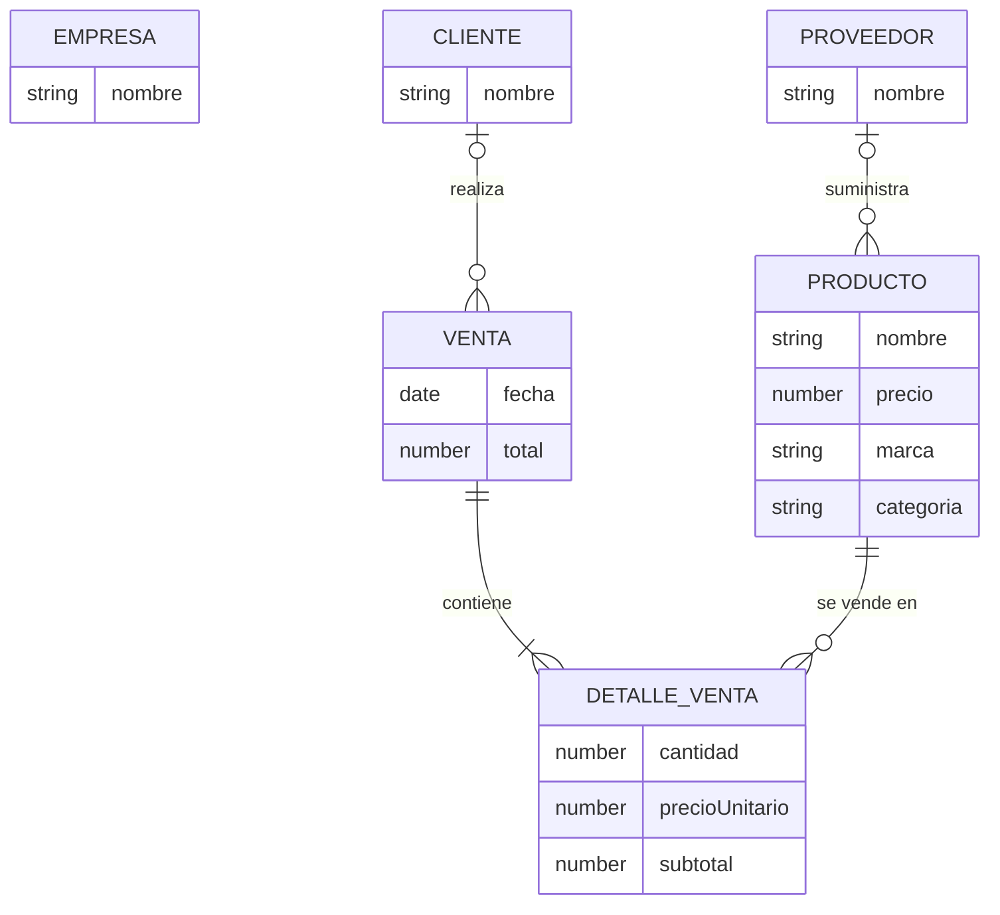

# Diagrama Entidad-Relación (conceptual)

Es una **representación conceptual** de los datos y sus asociaciones usando notación E-R tradicional. No implica que MongoDB use tablas ni llaves foráneas: en MongoDB las asociaciones se implementan con referencias `ObjectId` y un documento embebido (ver [modelo lógico](diseno-logico.md)).

`EMPRESA` no tiene relaciones: representa a la tienda (documento único).
